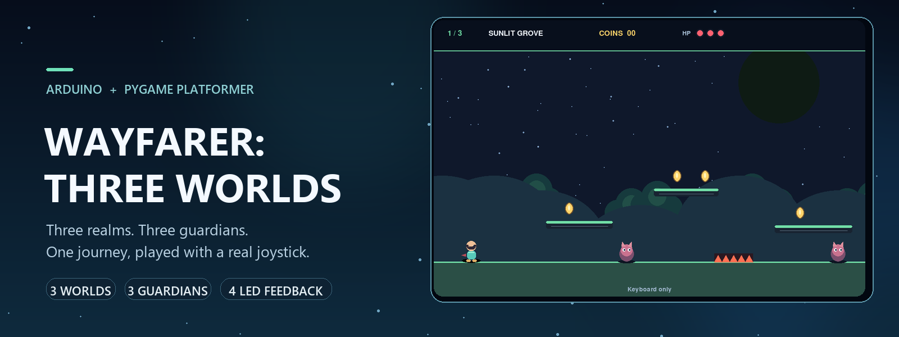
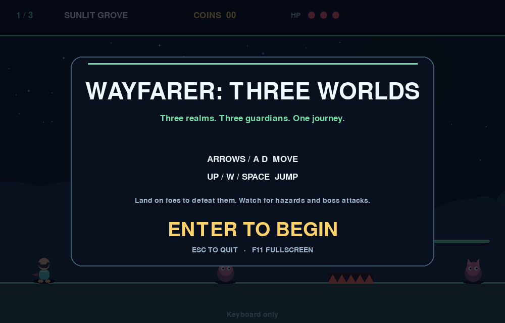
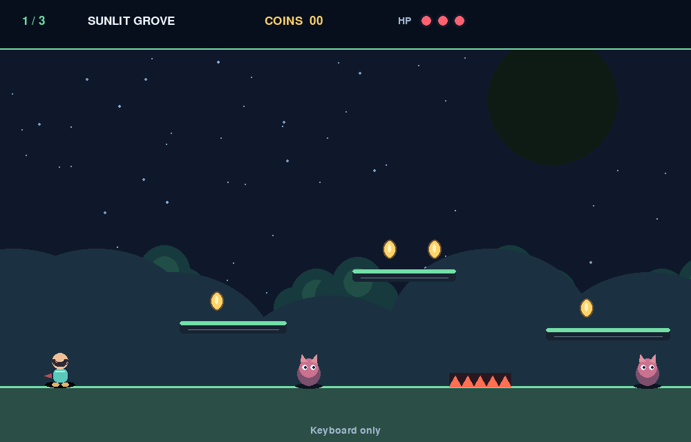
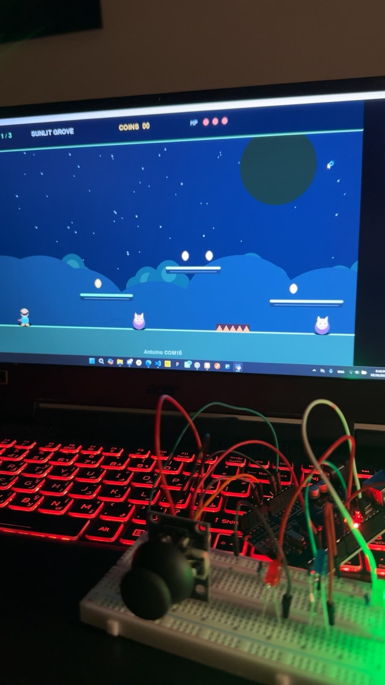
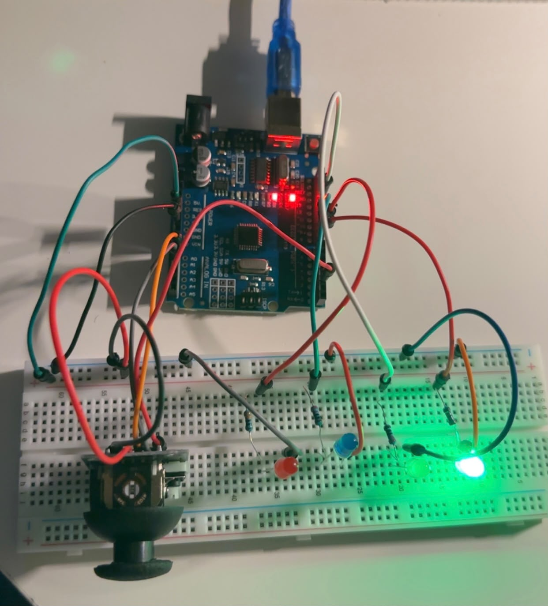
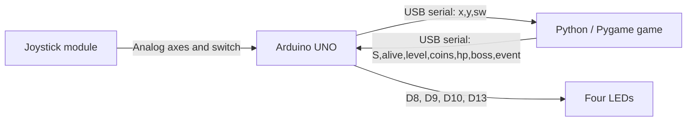

# Wayfarer: Three Worlds

A small 2D platform adventure controlled with a physical Arduino UNO joystick. The Python/Pygame game contains three themed levels, coins, patrolling enemies, health and damage, one guardian boss per level, and a final victory screen. Four Arduino LEDs reflect gameplay events.

## Features

- Keyboard-only or Arduino joystick control.
- Three distinct worlds with platforming, hazards, coins, enemies, and guardian encounters.
- Responsive movement, forgiving jump timing, damage feedback, and health.
- Four event-driven LEDs for life, danger, collections, and progression.
- Resizable window, F11 fullscreen, and keyboard controls when the Arduino is absent.

## Gameplay



*Main menu from the game renderer.*



*Opening area of Sunlit Grove, captured from the current Pygame game.*

## Hardware photographs



*The supplied wide photograph shows the game running above the joystick and breadboard setup.*



*The supplied close-up shows the UNO and assembled breadboard components. The photo is preserved as provided; individual connections are documented in the pin map below.*

## System overview



The Arduino samples the controller and drives the LEDs. Python owns game logic, levels, rendering, scoring, health, bosses, and the HUD.

## Hardware and wiring

Keep the existing tested pin assignments. Use a current-limiting resistor in series with each external LED, and connect joystick VCC and GND to the UNO's 5V and GND.

| Component | UNO pin | Purpose / orientation |
|---|---:|---|
| Joystick X axis | A0 | Physical up/down; low = down, high = up (jump) |
| Joystick Y axis | A1 | Physical left/right; low = left, high = right (horizontal movement) |
| Joystick switch | D2 | Read and sent as `sw`; not used as a game action |
| Green LED | D8 | Player alive; off when dead |
| Red LED | D9 | Damage and danger |
| Blue LED | D10 | Coin collection and interactions |
| Yellow LED | D13 | Level progression and boss events |

At final victory, the firmware blinks all four LEDs.

## Serial communication

Baud rate: **9600**. Each record is newline-terminated CSV.

- **Arduino → Python:** `x,y,sw` (A0 reading, A1 reading, switch; analog values 0–1023; switch `1` pressed, `0` released). The sketch sends samples every 20 ms.
- **Python → Arduino:** `S,alive,level,coins,hp,boss,event` (sent when game state changes). `alive` is 0/1, `level` is 1–3, and `boss` is 0 inactive, 1 active, 2 defeated. Events include `LEVEL`, `COIN`, `DAMAGE`, `DEATH`, `ENEMY`, `BOSS`, `BOSS_HIT`, `BOSS_DOWN`, and `WIN`; `-` means no active event.

The firmware files are `arduino_controller/arduino_controller.ino` (gameplay) and `hardware_test/hardware_test.ino` (independent joystick/LED diagnostic). Open each sketch from its matching folder in Arduino IDE. Select **Arduino Uno** and the connected port, then upload. Close Serial Monitor before launching the Python game because it holds the serial port.

## Install and run

In VS Code, open the project folder and use **Terminal → New Terminal**:

```powershell
python -m pip install -r requirements.txt
python game.py --keyboard-only
```

Arduino auto-detection:

```powershell
python game.py
```

Choose a serial port explicitly (replace `COM3` with the port shown on your computer):

```powershell
python game.py --port COM3
```

## Controls

- Left/Right arrows or A/D: move.
- Up arrow, W, or Space: jump.
- Enter: start, continue after a boss, or restart.
- F11: toggle fullscreen. Drag the window edge or use its maximize button to resize; the game preserves its proportions.
- Escape: quit.

## Testing notes

Keyboard-only startup, game-state smoke checks, and mocked serial protocol checks have been run in software. The photographs were supplied by the project owner; no physical Arduino or LED test was performed during this presentation update. Confirm the selected COM port and hardware behavior on the UNO before presenting.
